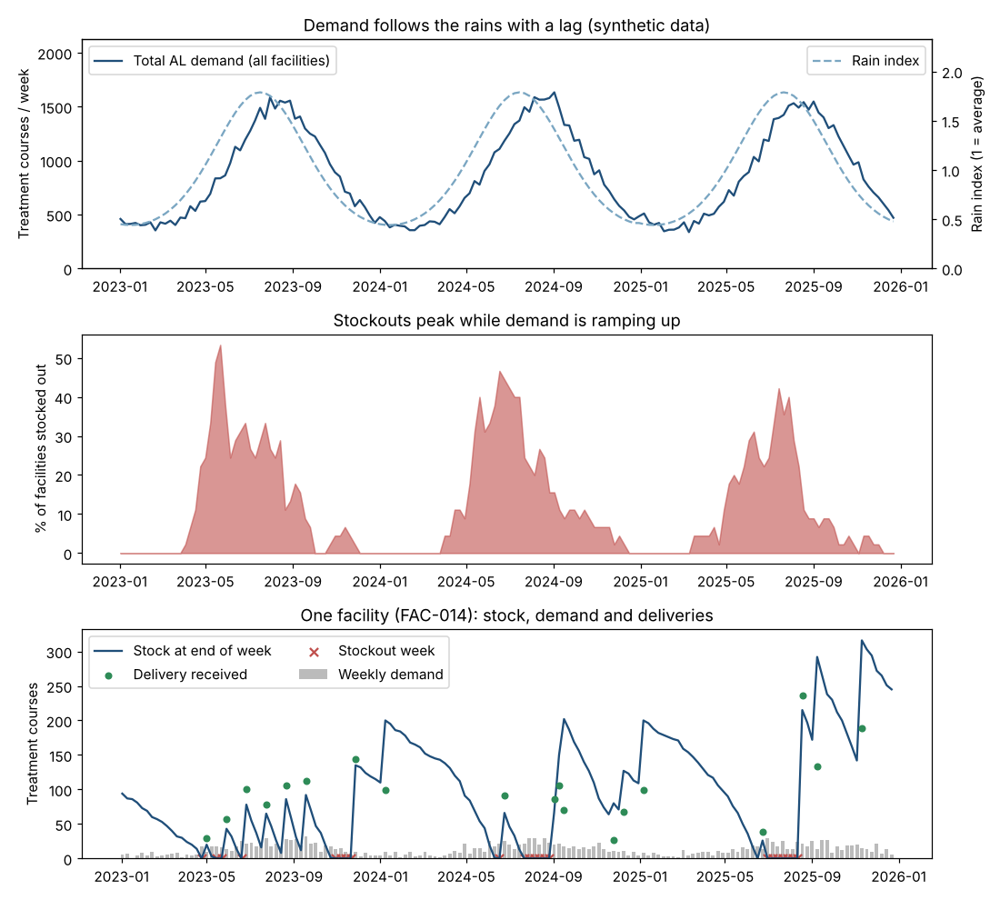
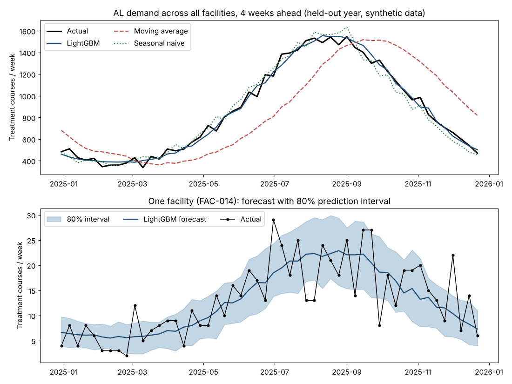

# Malaria Stockout-Risk Prototype

A small decision-support prototype that estimates which health facilities are likely to run out of essential malaria medicines, and (planned) where surplus stock near expiry could be redistributed.

**Status: v0.1, in progress. Started 10 November 2026.**

## Read this first

- **Built in response to a job posting.** This prototype was started in November 2026 in response to the third sample project in the Gates Foundation AI Fellow (Africa Regional Offices) posting: forecasting stockout risk and flagging redistribution opportunities before expiry. It is a learning and demonstration project, not production work and not done for any client.
- **The data is synthetic.** Facility-level stock and consumption data for Nigeria is not openly available. The generator in `src/stockout/` simulates seasonality, delivery delays and expiry. Results show that the method works on simulated data; they say nothing about real-world performance.
- **AI tools were used.** Much of the code was written with Claude (Anthropic) and reviewed and run by the repository owner. Commits made through Claude carry a `Co-Authored-By` line.

## Planned scope

| Stage | What | Status |
|---|---|---|
| v0.1 | Synthetic data generator, seasonal-naive baseline, gradient-boosting forecast with intervals, stockout-risk flag, Streamlit page, model card | In progress: data generator, forecast and evaluation done |
| Next | Real open data for facility locations and malaria seasonality (GRID3, Malaria Atlas Project, rainfall) | Planned |
| Next | Expiry-aware redistribution suggestions | Planned |
| Next | LLM explanation layer over public guideline documents, with a small evaluation set | Planned |
| Next | Fairness and robustness checks, tests in CI, hosted demo | Planned |

## Project layout

```
src/stockout/   Python package: data generation, models, risk flags
tests/          Unit tests
scripts/        Helper scripts, such as the overview plot
data/           Generated data (not committed; recreate with one command)
app/            Streamlit interface (added later)
docs/           Model card, figures, results tables and notes
```

## Run it

```bash
python -m venv .venv
source .venv/bin/activate
pip install -r requirements.txt
python -m pytest -q
```

Generate the synthetic data (writes `facilities.csv` and `weekly_stock.csv` to `data/synthetic/`) and draw the overview figure:

```bash
PYTHONPATH=src python -m stockout.data_gen --out data/synthetic
python scripts/plot_overview.py
python scripts/run_forecast_eval.py   # regenerates the data itself, then scores the forecasts
```

The generator uses seed 42 by default, so everyone gets identical data. See `src/stockout/data_gen.py` for what is simulated and `docs/figures/synthetic_overview.png` for the result.



## Changes

What was done at each phase, in order. Dates are real commit dates; nothing is backdated.

### Phase 0: Setup (10 November 2026)

- Created the public repo with an MIT license and a Python `.gitignore`.
- Wrote the README, stating up front that the project was built in response to a job posting, that the data is synthetic and that AI tools were used.
- Added `requirements.txt`, the `src/stockout/` package and a smoke test.

### Terminology glossary (11 November 2026)

- Added a glossary to the README, grouped by phase, so each new term is explained where it first matters.

### Phase 1: Synthetic data generator (11 November 2026)

- Added `src/stockout/data_gen.py`, a seeded generator that simulates weekly stock for two malaria commodities (artemether-lumefantrine and rapid diagnostic tests) across 45 facilities for 3 years (14,040 facility-commodity-week rows).
- Simulated seasonal demand that peaks 4 weeks after a rain index, scaled by facility catchment population, with noise.
- Simulated ordering from recent demand, random delivery delays (more often rural), partial fills, batch expiry with first-expired-first-out dispensing, write-offs, and occasional oversized short-dated push shipments.
- Added 16 tests (17 with the smoke test) covering reproducibility, stock conservation, seasonality, and stockout and expiry sanity checks.
- Added `scripts/plot_overview.py` and the overview figure.
- Result on the default seed (42): stockouts in about 12% of facility-weeks, peaking at about 53% of facilities in the wet-season ramp-up, higher in rural than urban facilities. About 0.4% of delivered stock expires.
- Finding: the first version had 37% stockout weeks because facilities planned orders from consumption, which stockouts hide, so each stockout made the next more likely. Planning from demand (including patients turned away) fixed it. A hidden-demand problem like this is called censored data (see the glossary).
- Known gap: no test checks the random delivery delays directly.

### Phase 2: Forecasting and evaluation (11 November 2026)

- Added `src/stockout/forecast.py`, which forecasts demand 4 weeks ahead (about one delivery lead time) for each facility and commodity.
- Features use only data up to the forecast date. Demand is modelled per 1,000 people so large and small facilities share one model.
- Compared two baselines (same week last year; average of the last 4 weeks) with LightGBM. Two extra LightGBM models estimate the 10th and 90th percentiles to give an 80% prediction interval.
- Split by date: trained on target weeks 20 March 2023 to 23 December 2024 (8,370 rows) and tested on 30 December 2024 to 22 December 2025 (4,680 rows). Every method is scored on the same test rows.
- Added 14 tests (31 in total), including a leakage test: cutting the data off at a date must not change any feature on or before it. I confirmed the test fails when a future-looking feature is planted.
- Added `scripts/run_forecast_eval.py`, the metrics tables in `docs/results/` and `docs/figures/forecast_eval.png`.

| Method | MAE | RMSE | MAE as % of mean demand |
|---|---|---|---|
| Moving average (last 4 weeks) | 8.12 | 12.47 | 33.8% |
| Seasonal naive (same week last year) | 6.64 | 10.15 | 27.7% |
| LightGBM without rain index | 4.78 | 7.25 | 19.9% |
| LightGBM with rain index | 4.79 | 7.27 | 20.0% |

Error is in courses or tests per facility-week; lower is better.



- Finding: LightGBM beats both baselines, with about 28% lower error than seasonal naive. The moving average is worst because it lags behind the rising season.
- Finding: the rain index adds nothing (MAE 4.79 vs 4.78). Calendar features already capture the seasonal cycle in this synthetic data.
- Finding: the 80% intervals hold 76% of actual values (77% for AL, 74% for RDT). They are slightly overconfident.
- Finding: the leakage test caught a design flaw while I was building it. The target week's calendar position was read from future rows of the table. It was not a demand leak, but it depended on future rows, so I replaced it with plain date arithmetic.
- Caveat: the synthetic seasonal pattern repeats identically every year. That flatters the seasonal-naive baseline and the calendar features. Real data would vary from year to year.
- Caveat: weekly demand contains random noise, so some error cannot be removed by any model.
- Known gaps: no hyperparameter tuning, no recalibration of the intervals, a single split rather than a rolling backtest, and still no test for the random delivery delays.

### Phase 3 onward

Not started. See the planned scope above.

## Terminology

A glossary grouped by the phase where each term first matters. It grows as the project does; phases 6-10 are planned, so their terms are previews.

### Phase 0: Setup

1. **Repository (repo):** A project folder tracked by Git, hosted here on GitHub.
2. **Commit:** A saved snapshot of the project with a message and a date. The history of commits is the project's record.
3. **Push:** Sending your local commits to the copy on GitHub.
4. **README:** The front page of a repo. It explains what the project is, how to run it and what its limits are.
5. **Virtual environment (venv):** An isolated set of Python packages for one project, so it doesn't clash with other projects on your machine.
6. **requirements.txt:** A list of the packages the project needs, so anyone can install the same set with one command.
7. **Fixed seed:** A starting number for a random number generator. With the same seed, the "random" data comes out identical every run, so anyone can reproduce your results.
8. **Reproducibility:** Anyone running the same code and seed gets the same numbers you did.
9. **Smoke test:** A tiny test that only checks the project loads and runs at all.
10. **License (MIT):** The terms for reusing the code. MIT lets others use it freely if they credit the author.

### Phase 1: Synthetic data generator

1. **Synthetic data:** Data invented by a program, not collected from real facilities. It lets you test a method when real data isn't available, but it can't prove real-world performance.
2. **Facility:** A health centre or clinic that holds stock and treats patients.
3. **Commodity:** A medicine or supply item tracked in the system, for example artemether-lumefantrine or a rapid test.
4. **Artemether-lumefantrine (AL):** A first-line combination treatment for uncomplicated malaria.
5. **Rapid diagnostic test (RDT):** A quick finger-prick test that detects malaria.
6. **Time series:** Measurements recorded at regular intervals, here weekly stock and consumption.
7. **Seasonality:** A pattern that repeats each year, such as malaria cases rising in the rainy season.
8. **Lag:** A delay between cause and effect, such as cases peaking a few weeks after rain.
9. **Noise:** Random variation added so the data looks like the real world rather than a smooth curve.
10. **Consumption:** How much of a commodity a facility uses in a period.
11. **Stock on hand:** The quantity physically available at a facility right now.
12. **Lead time:** The days between ordering stock and receiving it.
13. **Expiry date / shelf life:** The date after which a batch can't be used, and how long a batch lasts from manufacture.
14. **Catchment population:** The number of people a facility serves, which scales its demand.
15. **Unit test:** A small automatic check that one piece of code does what it should.
16. **Review period:** How often a facility checks its stock and decides whether to reorder, here every 4 weeks.
17. **Fill rate:** The share of an order that actually arrives. A fill rate of 80% means a facility asked for 100 and got 80.
18. **On order (pipeline stock):** Stock that has been ordered but has not arrived yet.
19. **Write-off:** Removing expired stock from the records because it can no longer be used.
20. **First-expired, first-out (FEFO):** Using the batches that expire soonest first. The generator does this when serving patients.
21. **Push shipment:** Stock sent to a facility that it did not ask for, often oversized or short-dated. It creates the surplus that may expire.
22. **Poisson distribution:** A standard way to generate random whole-number counts, such as how many patients arrive in a week.
23. **Opening and closing stock:** Stock at the start and end of a week. The tests check that closing = opening + received - expired - consumed, so no stock appears or vanishes.
24. **Censored data:** A measurement cut off by a limit. Consumption can never exceed stock, so a stockout hides true demand. Facilities that plan from consumption alone under-order, which causes a "stockout spiral"; the generator plans from demand, including patients turned away.
25. **Rain index:** A number showing how rainy a week is compared with an average week (1.0). Here it is a smooth invented curve. Real rainfall data arrives in Phase 6.

### Phase 2: Forecasting and evaluation

1. **Forecast:** A prediction of a future value, here weekly demand or stock.
2. **Baseline:** A simple method your model must beat to be worth using.
3. **Seasonal-naive:** A baseline that predicts "this week will look like the same week last year".
4. **Features:** The input columns a model learns from, such as last week's consumption, week of year or facility size.
5. **Gradient boosting (LightGBM):** A model made of many small decision trees, each correcting the mistakes of the ones before it.
6. **Train/test split:** Dividing data into a part the model learns from and a part held back to check it.
7. **Time-based split:** A split by date, training on earlier weeks and testing on later ones, because you never know the future in real use.
8. **Data leakage:** When information from the future sneaks into training, making results look better than they really are.
9. **Prediction interval:** A range expected to contain the true value a stated share of the time, for example 80%.
10. **Coverage:** How often the true value actually falls inside the prediction interval. If an 80% interval covers only 60%, it is overconfident.
11. **MAE / RMSE:** Two ways to measure forecast error. MAE is the average miss; RMSE punishes large misses more.
12. **Overfitting:** A model memorising its training data and then doing badly on new data.
13. **Forecast horizon:** How far ahead you predict. Here it is 4 weeks, roughly the time between ordering and delivery, so the forecast is available when an ordering decision is made.
14. **Rate per 1,000 people:** Demand divided by catchment population in thousands. It lets one model learn from large and small facilities alike.
15. **Quantile regression:** Training a model to predict a chosen percentile, such as the 10th or 90th, instead of the average. Two of them together form the prediction interval.
16. **Leak-free features:** Inputs built only from data available at the forecast date. The leakage test checks this by cutting the data off at a date and confirming no feature changes.
17. **Ablation:** Removing one ingredient to see what it contributes. Here, the model is fitted with and without the rain index.
18. **Irreducible error:** Error that no model can remove because the outcome is partly random, such as the random number of patients in a week.

### Phase 3: Stockout-risk flag

1. **Stockout:** Having no stock of a commodity when someone needs it.
2. **Safety stock (safety level):** A minimum quantity kept as a buffer against delays and surges.
3. **Probability:** A number from 0 to 1 for how likely something is. A risk of 0.7 means about a 70% chance.
4. **Threshold:** The cut-off above which a facility is flagged, for example flag when risk exceeds 0.5.
5. **Precision:** Of the facilities flagged, the share that really ran out. High precision means few false alarms.
6. **Recall:** Of the facilities that really ran out, the share you flagged. High recall means few missed stockouts.
7. **False positive / false negative:** A false alarm, and a missed real stockout.
8. **Confusion matrix:** A table counting true and false positives and negatives.
9. **Class imbalance:** When one outcome is much rarer than the other, such as stockouts being rare, which makes simple accuracy misleading.
10. **Calibration:** Whether predicted probabilities match reality, so that of the cases given 70% risk, about 70% really happen.

### Phase 4: Interface

1. **Streamlit:** A Python library that turns a script into an interactive web page.
2. **Dashboard:** A single screen that summarises key information for a decision-maker.
3. **Ranked list:** Facilities sorted so the highest-risk appear first.
4. **Explainability:** Showing why a result was produced, in terms a non-technical user can follow.
5. **Caching:** Keeping a computed result in memory so the page doesn't recompute it on every click.

### Phase 5: README and model card

1. **Model card:** A short document describing what a model does, what data it used, how well it works and where it should not be used.
2. **Limitations:** An honest statement of what the project can't tell you.
3. **Architecture diagram:** A picture showing the parts of the system and how data flows between them.
4. **Provenance:** Where each piece of data came from, and how it was changed.

### Phase 6: Real open data (planned)

1. **GRID3:** A programme that publishes open geospatial data for Nigeria, including health facility locations.
2. **Humanitarian Data Exchange (HDX):** An open platform where datasets like the facility list are shared.
3. **Malaria Atlas Project (MAP):** A research group publishing open maps of malaria risk and prevalence.
4. **Prevalence:** The share of a population infected at a given time.
5. **Geospatial data:** Data tied to locations on the map, such as coordinates.
6. **GeoJSON / shapefile:** Common file formats for geospatial data.
7. **Local Government Area (LGA):** A Nigerian administrative area below the state.
8. **Rainfall data (for example CHIRPS):** Satellite-based rainfall records, used here as a driver of malaria seasonality.
9. **Join (merge):** Combining two tables by a shared key, such as a facility ID.
10. **Data terms of use:** The conditions attached to a dataset, to be checked before reuse.

### Phase 7: Redistribution logic (planned)

1. **Redistribution:** Moving surplus stock from one facility to another that is short.
2. **Surplus / shortfall:** Stock above, or below, what a facility is expected to need.
3. **Expiry-aware matching:** Pairing surplus close to expiry with nearby shortfalls so it is used rather than wasted.
4. **First-expired, first-out (FEFO):** Using the batches that expire soonest first (already used in the Phase 1 generator).
5. **Constraint:** A rule a solution must respect, for example staying within the same district.
6. **Greedy algorithm:** A simple method that makes the best-looking choice at each step without reconsidering.
7. **Optimisation:** Finding the best allocation under the constraints.

### Phase 8: LLM explanation layer (planned)

1. **Large language model (LLM):** A model trained on text that can read and write language.
2. **Prompt:** The instructions and context you give an LLM.
3. **Retrieval-augmented generation (RAG):** Fetching relevant passages from your documents and giving them to the LLM, so its answer rests on those sources.
4. **Embedding:** A list of numbers representing the meaning of a piece of text, used to find similar passages.
5. **Chunking:** Splitting documents into passages small enough to retrieve and cite.
6. **Grounding / citation:** Tying each statement to the source passage it came from.
7. **Hallucination:** A confident answer that is not supported by the sources or by facts.
8. **Abstention (refusal):** The model saying it can't answer from the sources, rather than guessing.
9. **Evaluation set:** A fixed list of test questions with known good answers, used to measure the system.

### Phase 9: Fairness and robustness (planned)

1. **Bias:** Systematically worse results for some group.
2. **Subgroup analysis:** Reporting performance separately for groups, such as small vs large or rural vs urban facilities.
3. **Fairness:** Checking that the tool does not serve some places much worse than others.
4. **Robustness:** Whether the tool still works under messy conditions.
5. **Stress test:** Deliberately breaking inputs, for example removing data or delaying deliveries, to see how results change.
6. **Missing data / imputation:** Gaps in the records, and filling them with estimated values.
7. **Distribution shift:** When real-world data stops resembling the data the model was trained on.

### Phase 10: Polish (planned)

1. **Continuous integration (CI):** Running tests automatically every time code is pushed.
2. **GitHub Actions:** GitHub's built-in tool for running CI.
3. **Test coverage:** The share of the code that the tests exercise.
4. **Linting:** Automatic checks for style problems and likely mistakes.
5. **Deployment:** Putting the app online so others can use it.
6. **Release tag / versioning:** A named, dated marker such as `v0.1.0` for a version of the project.

## Limitations

To be completed with the model card. In short: synthetic data, a small number of facilities and medicines, and no validation against real logistics records.

## License

MIT (see `LICENSE`).
